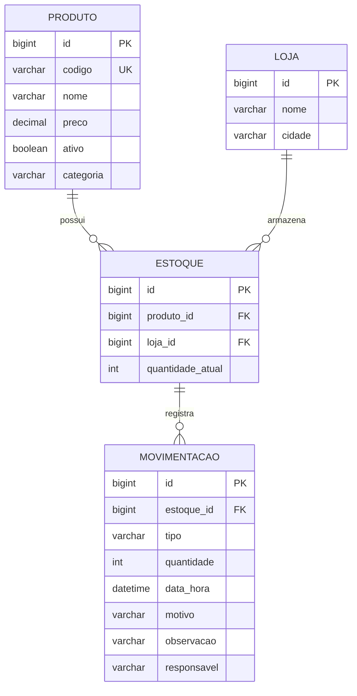

# StockTrace — V2

API REST de controle de estoque por loja, desenvolvida em Java com Spring Boot e Spring Data JPA. Permite cadastrar lojas e produtos, associá-los a estoques e registrar entradas e saídas com histórico.

A V1 foi construída com Java, JDBC e menu no console. Na V2, a interface passou a ser HTTP, os repositories usam JPA e as transações são gerenciadas pelo Spring. A versão Maven atual é `2.0-SNAPSHOT`.

## Funcionalidades

- **Lojas e produtos:** cadastro, consulta, atualização e exclusão. Produtos também possuem busca por código, categoria e ativação/desativação.
- **Estoques:** cadastro por combinação de produto e loja, listagem e consulta de saldo.
- **Movimentações:** entradas, saídas e histórico, com quantidade, motivo, responsável, data/hora e observação opcional. Saídas com saldo insuficiente são rejeitadas.
- **Erros HTTP:** tratamento centralizado de dados inválidos, recursos inexistentes, saldo insuficiente e violações de integridade.

## Tecnologias

| Tecnologia | Uso |
| --- | --- |
| Java 26 | Linguagem e versão configurada no projeto |
| Spring Boot 4.1.1 | Inicialização, configuração e gerenciamento de dependências |
| Spring Web MVC | Controllers HTTP e servidor embarcado |
| Spring Data JPA / Hibernate | Mapeamento das entidades e persistência |
| MySQL / InnoDB | Banco relacional, transações e restrições |
| MySQL Connector/J | Driver, com versão gerenciada pelo Spring Boot |
| Maven | Dependências e build |
| Insomnia | Testes manuais dos endpoints |

## Arquitetura

| Package | Responsabilidade |
| --- | --- |
| `controller` | Receber requisições e construir respostas HTTP |
| `dto` | Definir os dados de entrada usando records |
| `service` | Validar dados e coordenar operações e transações |
| `repository` | Consultar e persistir dados com Spring Data JPA |
| `model` | Mapear entidades e encapsular comportamentos do domínio |
| `exception` | Representar erros de negócio e traduzi-los em respostas HTTP |

A injeção de dependências ocorre pelos construtores. O projeto utiliza conceitos de modelagem de domínio e encapsulamento inspirados em DDD, sem pretender implementar DDD completo. Por exemplo, `Estoque.retirar` protege o saldo contra retiradas acima da quantidade disponível.

```text
StockTrace/
├── database/schema.sql
├── src/main/
│   ├── java/org/stocktrace/
│   │   ├── controller/
│   │   ├── dto/
│   │   ├── exception/
│   │   ├── model/
│   │   ├── repository/
│   │   ├── service/
│   │   └── StockTraceApplication.java
│   └── resources/
│       ├── application.properties
│       └── config.properties (criado localmente e ignorado pelo Git)
├── pom.xml
└── README.md
```

## Regras e transações

- Cada combinação de produto e loja possui, no máximo, um estoque. O schema também define uma restrição única para esse par.
- Um estoque novo começa com saldo zero; o código do produto é único.
- Quantidades de movimentação devem ser positivas e saídas não podem ultrapassar o saldo disponível.
- Entradas verificam se a soma ultrapassa o limite de `int`.
- Motivo e responsável são obrigatórios; observação é opcional.
- Produtos exigem preço positivo e categoria válida. A descrição tem limite de 255 caracteres no service.
- Lojas exigem os dados de endereço, exceto complemento. O CEP aceita oito dígitos com ou sem hífen.
- O schema restringe a exclusão de lojas e produtos com estoques vinculados e de estoques com movimentações.

`registrarEntrada` e `registrarSaida` são transacionais. Ambos buscam o estoque com `PESSIMISTIC_WRITE`, alteram a entidade gerenciada e salvam a movimentação. O Hibernate persiste o saldo na mesma transação que registra o histórico; uma exceção que provoque rollback impede a confirmação parcial.

O bloqueio coordena movimentações concorrentes sobre o mesmo estoque. Testes específicos de concorrência e falha durante a gravação ainda estão pendentes.

## Como executar

### 1. Preparar o ambiente

Tenha JDK 26, Maven e um servidor MySQL compatível com o script, incluindo as restrições `CHECK`. O ambiente de desenvolvimento utilizou MySQL 8.0.46. Use MySQL Workbench ou outro cliente SQL para preparar o banco.

Abra o `pom.xml` no IntelliJ IDEA como projeto Maven, selecione o JDK 26 e carregue as dependências.

### 2. Criar o banco

Abra `database/schema.sql` no MySQL Workbench e execute com um usuário autorizado a criar bancos e tabelas. O script cria o banco `stocktrace` e as tabelas `loja`, `produto`, `estoque` e `movimentacao`, inicialmente sem dados.

O script se destina a um banco novo. `CREATE TABLE IF NOT EXISTS` não altera tabelas existentes nem migra um banco da V1. A inicialização completa da V2 em um banco novo criado por esse script ainda precisa ser validada.

### 3. Configurar a conexão

Crie `src/main/resources/config.properties` com os dados do seu ambiente. Exemplo com valores fictícios:

```properties
db.url=jdbc:mysql://localhost:3306/stocktrace
db.user=SEU_USUARIO
db.password=SUA_SENHA
```

O usuário precisa de permissão para ler e gravar nas tabelas. Esse arquivo é ignorado pelo Git e não deve ser versionado com credenciais reais.

O `application.properties` importa a configuração local e utiliza:

```properties
spring.config.import=classpath:config.properties
spring.datasource.url=${db.url}
spring.datasource.username=${db.user}
spring.datasource.password=${db.password}
spring.jpa.hibernate.ddl-auto=validate
spring.jpa.open-in-view=false
```

`validate` verifica a compatibilidade dos mapeamentos ao iniciar, sem criar ou atualizar tabelas. `open-in-view=false` desativa a manutenção do contexto de persistência durante toda a requisição web. O arquivo local importado precisa existir.

### 4. Iniciar a API

No IntelliJ, execute `org.stocktrace.StockTraceApplication`. Ou, com Maven instalado e usando JDK 26, execute na raiz:

```bash
mvn spring-boot:run
```

A URL local padrão é `http://localhost:8080`. Consulte `/lojas` para começar; não existe uma página de apresentação na rota `/`.

## Endpoints

Todas as rotas abaixo são relativas à URL base. POSTs de criação retornam a entidade e o cabeçalho `Location`. Respostas de sucesso são JSON, exceto exclusões, que retornam `204` sem corpo.

### Lojas

| Método | Rota | Operação | Sucesso |
| --- | --- | --- | --- |
| GET | `/lojas` | Listar | 200 |
| GET | `/lojas/{id}` | Buscar por ID | 200 |
| POST | `/lojas` | Cadastrar | 201 |
| PUT | `/lojas/{id}` | Atualizar | 200 |
| DELETE | `/lojas/{id}` | Excluir | 204 |

### Produtos

| Método | Rota | Operação | Sucesso |
| --- | --- | --- | --- |
| GET | `/produtos` | Listar | 200 |
| GET | `/produtos/{id}` | Buscar por ID | 200 |
| GET | `/produtos/codigo/{codigo}` | Buscar por código | 200 |
| POST | `/produtos` | Cadastrar | 201 |
| PUT | `/produtos/{id}` | Atualizar nome, descrição, preço e unidade | 200 |
| DELETE | `/produtos/{id}` | Excluir | 204 |
| PATCH | `/produtos/{id}/ativar` | Ativar | 200 |
| PATCH | `/produtos/{id}/desativar` | Desativar | 200 |
| PATCH | `/produtos/{id}/categoria` | Alterar categoria | 200 |

Ativação e desativação não recebem corpo. Produtos novos são criados ativos.

### Estoques

| Método | Rota | Operação | Sucesso |
| --- | --- | --- | --- |
| GET | `/estoques` | Listar | 200 |
| GET | `/estoques/{id}` | Buscar por ID | 200 |
| GET | `/estoques/produto/{produtoId}/loja/{lojaId}` | Buscar pela combinação | 200 |
| POST | `/estoques` | Associar produto e loja | 201 |

Não há endpoint para editar diretamente o saldo ou excluir estoques.

### Movimentações

| Método | Rota | Operação | Sucesso |
| --- | --- | --- | --- |
| GET | `/movimentacoes` | Listar | 200 |
| GET | `/movimentacoes/{id}` | Buscar por ID | 200 |
| GET | `/movimentacoes/estoques/{estoqueId}` | Consultar histórico do estoque | 200 |
| POST | `/movimentacoes/entrada` | Registrar entrada | 201 |
| POST | `/movimentacoes/saida` | Registrar saída | 201 |

Não há endpoints de edição ou exclusão do histórico. O tipo e a data/hora são definidos pela aplicação, não pelo JSON de entrada.

## Exemplos no Insomnia

Crie uma requisição com o método e a URL desejados. Para enviar os exemplos, selecione **Body → JSON** (`Content-Type: application/json`). GETs e DELETEs não precisam de corpo.

Os IDs abaixo são ilustrativos: substitua-os pelos retornados no seu ambiente. Cada cadastro e movimentação grava dados no banco configurado.

### Loja — POST `/lojas` ou PUT `/lojas/{id}`

```json
{
  "nome": "Loja Centro",
  "cidade": "São Paulo",
  "bairro": "Centro",
  "rua": "Rua das Flores",
  "numero": "100",
  "complemento": null,
  "cep": "01000-000"
}
```

### Produto — POST `/produtos`

```json
{
  "codigo": "ARR001",
  "nome": "Arroz 5kg",
  "descricao": "Arroz branco tipo 1",
  "preco": 29.90,
  "unidadeMedida": "UN",
  "categoria": "MERCEARIA"
}
```

Categorias disponíveis: `MERCEARIA`, `HORTIFRUTI`, `ACOUGUE_E_FRIOS`, `PADARIA`, `BEBIDAS`, `HIGIENE_E_LIMPEZA` e `OUTROS`.

### Atualização de produto — PUT `/produtos/{id}`

```json
{
  "nome": "Arroz branco 5kg",
  "descricao": "Arroz branco selecionado",
  "preco": 31.90,
  "unidadeMedida": "UN"
}
```

Código e categoria não são alterados por esse endpoint.

### Categoria — PATCH `/produtos/{id}/categoria`

```json
{
  "categoria": "MERCEARIA"
}
```

### Estoque — POST `/estoques`

```json
{
  "produtoId": 1,
  "lojaId": 1
}
```

Cadastre o produto e a loja antes. A combinação ainda não pode ter estoque. O saldo inicial será zero.

### Entrada — POST `/movimentacoes/entrada`

```json
{
  "estoqueId": 1,
  "quantidade": 10,
  "motivo": "Reposição",
  "observacao": "Recebimento de mercadoria",
  "responsavel": "Lipe"
}
```

### Saída — POST `/movimentacoes/saida`

```json
{
  "estoqueId": 1,
  "quantidade": 3,
  "motivo": "Venda",
  "observacao": null,
  "responsavel": "Lipe"
}
```

Exemplo ilustrativo de fluxo: após criar um estoque com saldo zero, registrar a entrada de 10 e a saída de 3, `GET /estoques/{id}` deve mostrar saldo 7, desde que não ocorram outras movimentações. Consulte `GET /movimentacoes/estoques/{estoqueId}` para conferir os dois registros.

## Tratamento de erros

`TratadorDeExcecoes` utiliza `@RestControllerAdvice`. Os handlers atuais retornam **texto simples**, sem envelope JSON padronizado.

| Exceção | HTTP | Corpo |
| --- | --- | --- |
| `DadosInvalidosException` | 400 | Mensagem da validação |
| `EntidadeNaoEncontradaException` | 404 | Mensagem com o recurso não encontrado |
| `EstoqueInsuficienteException` | 409 | Mensagem de saldo insuficiente |
| `DataIntegrityViolationException` | 409 | Mensagem genérica de restrição dos dados |

Exemplo de corpo para uma saída acima do saldo:

```text
Quantidade insuficiente em estoque.
```

Violações de integridade retornam:

```text
Não foi possível concluir a operação porque ela viola uma restrição dos dados.
```

A busca de estoque por produto e loja retorna `404` **sem corpo** quando ambos existem, mas a combinação não possui estoque. Erros de conversão de JSON e outras exceções não possuem handlers personalizados nessa classe; o formato de resposta pode diferir.

## Modelo de dados



O diagrama mostra os campos principais. A definição completa está no arquivo `database/schema.sql`. O par `(produto_id, loja_id)` é único; o schema não utiliza exclusão em cascata nesses relacionamentos.

## Validação e limitações atuais

Foram realizados testes manuais no Insomnia durante o desenvolvimento, incluindo operações dos controllers e respostas 400, 404 e 409. Isso não representa cobertura completa de todos os cenários.

Pendências e limites conhecidos:

- As validações dos services não cobrem todos os limites de tamanho e precisão definidos nas colunas do banco.
- As consultas de listagem não possuem paginação nem ordenação explícita.
- Os controllers retornam entidades diretamente; estoques e movimentações incluem objetos relacionados nas respostas. Esses objetos refletem os dados atuais, não uma cópia histórica dos dados de produto e loja.
- A desativação de produto altera o campo `ativo`, mas atualmente não bloqueia movimentações de seus estoques.
- Não há autenticação ou autorização. O responsável pela movimentação é informado como texto na requisição.

## Próxima evolução

Implementar usuários, cadastro e login com Spring Security, armazenamento de senhas como hash e permissões de acesso. Com autenticação, o responsável pela movimentação poderá ser obtido do usuário autenticado.

Essas funcionalidades são planejadas e ainda não fazem parte da V2 atual.
